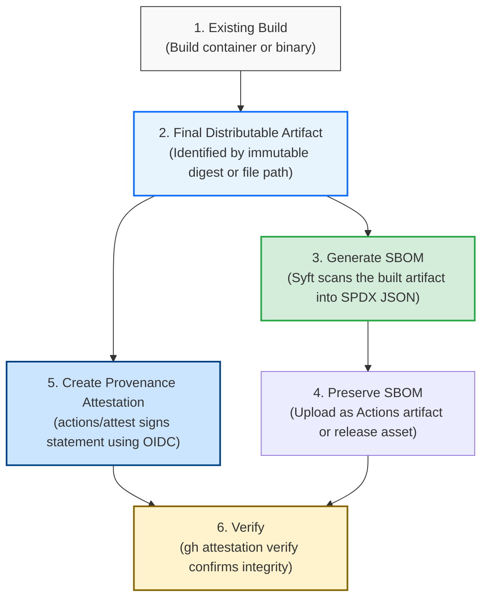

# OSS-SLU Supply-Chain Security Baseline: SBOM and Build Provenance

---

## Table of Contents

1. [What Are We Trying to Accomplish?](#1-what-are-we-trying-to-accomplish)
2. [The OSS-SLU Baseline at a Glance](#2-the-oss-slu-baseline-at-a-glance)
3. [Normative Language: MUST, SHOULD, and MAY](#3-normative-language-must-should-and-may)
4. [Choosing What to Scan](#4-choosing-what-to-scan)
5. [Standard SBOM Format](#5-standard-sbom-format)
6. [Generating SBOMs with Syft](#6-generating-sboms-with-syft)
7. [Preserving the SBOM](#7-preserving-the-sbom)
8. [Build Provenance and Artifact Attestations](#8-build-provenance-and-artifact-attestations)
9. [Permissions Explained](#9-permissions-explained)
10. [Complete Container Reference Workflow](#10-complete-container-reference-workflow)
11. [Complete Packaged Application Reference Workflow](#11-complete-packaged-application-reference-workflow)
12. [Matrix and Multi-Artifact Builds](#12-matrix-and-multi-artifact-builds)
13. [Complete Web Application & Workspace Reference Workflow](#13-complete-web-application--workspace-reference-workflow)
14. [Game Engine and Local Packaging Reference Guide](#14-game-engine-and-local-packaging-reference-guide)
15. [Verifying Attestations and SBOMs](#15-verifying-attestations-and-sboms)
16. [Out of Scope](#16-out-of-scope)
17. [Troubleshooting Guide](#17-troubleshooting-guide)
18. [Beginner Implementation Checklist](#18-beginner-implementation-checklist)
19. [Official Documentation & Learning Resources](#19-official-documentation--learning-resources)
20. [Appendix: Target Project Validation Table](#20-appendix-target-project-validation-table)

---

## 1. What Are We Trying to Accomplish?

When someone downloads or deploys an application produced by OSS-SLU, they need to know two essential things:
1. **What is inside this software?** (What libraries, modules, packages, and system components are baked in?)
2. **Where did this specific file or container come from?** (Was it truly built by our automated CI/CD pipeline from our repository, or was it altered or forged?)

To answer these questions reliably, we establish an automated baseline in our GitHub Actions build pipelines.

```
+-----------------------------------------------------------------------------------+
|  THE ARTIFACT: The finished food product (e.g., a frozen pizza box)               |
+-----------------------------------------------------------------------------------+
|  THE SBOM: The ingredient label printed on the box                                |
|  - Lists flour, yeast, cheese, tomato sauce, and their exact suppliers/versions.  |
+-----------------------------------------------------------------------------------+
|  THE BUILD PROVENANCE: The certified factory shipping receipt                     |
|  - States: "Packaged at Factory #42 on Line 3 from Batch #901 at 14:30 UTC."      |
+-----------------------------------------------------------------------------------+
|  THE ATTESTATION: An official tamper-evident holographic seal                     |
|  - Cryptographically glues the recipe and receipt to the box so nobody can swap  |
|    the contents or forge the origin.                                              |
+-----------------------------------------------------------------------------------+
```

### Key Definitions

* **Artifact**: The actual software output that end users run, install, or deploy. Examples include a Docker container image pushed to a registry, a compiled `.exe` desktop application, or a packaged `.zip` release archive.
* **Software Bill of Materials (SBOM)**: A structured, machine-readable inventory of all third-party libraries, packages, operating system packages, and dependencies included in an artifact.
* **Build Provenance**: Verifiable evidence detailing the manufacturing history of the artifact. It records *which* source repository, *which* Git commit SHA, *which* build workflow file, and *which* build runner produced the artifact.
* **Attestation**: A cryptographically signed statement that binds information (such as build provenance or an SBOM) to a specific artifact's cryptographic hash (digest).

> [!IMPORTANT]
> **Keep these concepts distinct:**
> * **SBOM $\neq$ Provenance**: An SBOM tells you *what components are inside* the artifact. Provenance tells you *who built it and how it was produced*. An artifact can have an SBOM without provenance, or provenance without an SBOM. OSS-SLU requires **both**.

---

## 2. The OSS-SLU Baseline at a Glance

Every OSS-SLU repository that produces deployable or distributable artifacts follows this straightforward progression:



1. **Build the artifact** using your project's existing build steps.
2. **Identify the exact output** being distributed (its local file path or immutable container SHA-256 digest).
3. **Generate an SBOM** targeting that exact built output in standard SPDX 2.3 JSON format.
4. **Preserve the SBOM** as a downloadable workflow artifact or release asset.
5. **Generate a build provenance attestation** using GitHub's native attestation action.
6. **Publish the artifact** to its designated registry or release page.
7. **Verify the attestation** using the GitHub CLI (`gh attestation verify`).
8. **Document where to find and verify** both outputs in the project's documentation.

---

## 3. Normative Language: MUST, SHOULD, and MAY

To give developers clear guidance without imposing rigid constraints on varied academic projects, this document uses standard terms:

* **MUST**: An absolute requirement of the baseline. Every adopting project has to achieve this outcome.
  * *Example*: The workflow **MUST** generate an SBOM and **MUST** attest the artifact's digest or file path.
* **SHOULD**: The default, recommended OSS-SLU convention. Projects are expected to follow this unless a technical constraint justifies doing otherwise.
  * *Example*: Workflows **SHOULD** output SBOMs in SPDX 2.3 JSON format using Syft.
* **MAY**: An optional enhancement or project-specific adaptation.
  * *Example*: A project **MAY** generate separate SBOMs for client and server containers.

---

## 4. Choosing What to Scan

One of the most common beginner pitfalls is running an SBOM tool against the Git source code repository and assuming the output describes the finished software. **It does not.**

Consider a Python desktop application: your Git repository might only contain `main.py` and `requirements.txt`. When PyInstaller compiles it into an executable bundle, it packages the Python interpreter, shared C libraries, UI toolkits, and platform-specific `.dll` or `.dylib` files. An SBOM that only scans `requirements.txt` misses the runtime software running on the user's machine.

> [!IMPORTANT]
> **Core Rule**: The scan target determines what the SBOM actually describes. Always point your scanner at the target most representative of the software users actually receive.

```
+---------------------------+-------------------------------------------------------+----------------------------------------------------------+
| Artifact Type             | Recommended Scan Target                               | Why?                                                     |
+---------------------------+-------------------------------------------------------+----------------------------------------------------------+
| Container Image           | The final built container image                       | Syft inspects both the OS layer (Debian/Alpine packages) |
| (Docker / OCI)            | Example: `ghcr.io/oss-slu/app@sha256:...`             | and the language runtime layer (pip, npm, gems).         |
+---------------------------+-------------------------------------------------------+----------------------------------------------------------+
| Packaged Binary Bundle    | The assembled build directory before packaging        | Inspects the complete set of bundled dependencies,       |
| (e.g., PyInstaller onedir)| Example: `./dist/MyDesktopApp/`                       | runtime binaries, and vendor libraries.                  |
+---------------------------+-------------------------------------------------------+----------------------------------------------------------+
| Packaged ZIP Archive      | The staged directory that becomes the ZIP             | Accurately captures every file and library packaged      |
|                           | Example: Staging directory before `zip` is executed   | inside the archive.                                      |
+---------------------------+-------------------------------------------------------+----------------------------------------------------------+
| Multi-Platform Releases   | Scan each platform's built bundle separately          | macOS and Windows binaries bundle different native       |
| (e.g., Windows vs. macOS) | Example: `Saltify_windows` vs. `Saltify_macos`        | libraries and platform-specific binaries.                |
+---------------------------+-------------------------------------------------------+----------------------------------------------------------+
```

### Scan Target Fallbacks
If Syft cannot discover dependencies from a specialized binary output format (such as a PyInstaller single-file `--onefile` binary):
1. **First Choice**: Scan the assembled staging directory *before* the final compression/bundling step occurs.
2. **Second Choice**: Scan the resolved virtual environment or installed dependencies directory in the runner.
3. **Fallback**: Scan the project root containing lockfiles (`path: .`), and clearly document that the SBOM reflects declared build dependencies rather than unpacked binary contents.

---

## 5. Standard SBOM Format

* **The OSS-SLU Standard Format**: **SPDX 2.3 JSON** (`spdx-json`).
* **Official Specification**: [SPDX Specification Version 2.3](https://spdx.github.io/spdx-spec/v2.3/) (ISO/IEC 5962:2021).

### Why SPDX JSON?
1. **Open Standard**: SPDX is recognized internationally by ISO/IEC, ensuring compatibility across open-source and enterprise tooling.
2. **JSON Format**: Easy to parse with standard command-line tools like `jq`, Python, and web dashboards.
3. **Tool Support**: Directly supported by Syft, Trivy, GitHub, and Kubernetes tooling.

### File Naming Convention
All generated SBOM files **SHOULD** follow this naming pattern:
```text
<artifact-name>-sbom.spdx.json
```
* *Examples*:
  * Container: `shelter-volunteers-server-sbom.spdx.json`
  * Packaged app: `Mouser_windows-latest-sbom.spdx.json`
  * Release zip: `Saltify_macos-sbom.spdx.json`

> [!NOTE]
> **CycloneDX Exception**: If an adopting project uses specialized ecosystem tooling that natively generates CycloneDX JSON (for example, specific Maven, Gradle, or Rust plugins), CycloneDX JSON **MAY** be used. Document the technical reason in the pull request.

---

## 6. Generating SBOMs with Syft

[Syft](https://github.com/anchore/syft) is an open-source command-line tool developed by Anchore for cataloging dependencies from container images and filesystems.

### Local Testing with Syft
You can test Syft on your local development machine:

```bash
# Install Syft (macOS via Homebrew)
brew install syft

# Install Syft (Linux via curl)
curl -sSfL https://raw.githubusercontent.com/anchore/syft/main/install.sh | sh -s -- -b /usr/local/bin

# Example 1: Generate an SBOM for a local built output folder
syft dir:./dist/my-app -o spdx-json=my-app-sbom.spdx.json

# Example 2: Generate an SBOM for a local Docker image
syft my-docker-image:latest -o spdx-json=my-image-sbom.spdx.json
```

### GitHub Actions Integration
In GitHub Actions workflows, use the official [`anchore/sbom-action@v0`](https://github.com/anchore/sbom-action) action.

#### Example A: Scanning an Immutable Container Image
```yaml
# Step: Generate an SBOM from the newly built, pushed container image
# IMPORTANT: Scan the exact immutable digest that was just published
- name: Generate Container SBOM
  uses: anchore/sbom-action@v0
  with:
    # Use the immutable digest (sha256:...) to ensure the SBOM
    # describes the exact image that was built and attested
    image: ${{ env.IMAGE_NAME }}@${{ steps.build_push.outputs.digest }}
    
    # Standard OSS-SLU output format
    format: spdx-json
    
    # Destination file path in the runner workspace
    output-file: my-service-sbom.spdx.json
```

#### Example B: Scanning an Assembled Application Directory
```yaml
# Step: Generate an SBOM from the compiled application directory
- name: Generate Application Bundle SBOM
  uses: anchore/sbom-action@v0
  with:
    # Point Syft at the directory containing the assembled application files
    path: ./dist/my-app
    
    # Standard OSS-SLU output format
    format: spdx-json
    
    # Destination file path in the runner workspace
    output-file: my-app-sbom.spdx.json
```

---

## 7. Preserving the SBOM

Generating an SBOM provides no value if it is discarded when the runner shuts down. The SBOM **MUST** be preserved so developers and users can download and inspect it.

```
+------------------------------------+---------------------------------------+-------------------------------------------+
| Preservation Option                | Storage Location                      | When to Use                               |
+------------------------------------+---------------------------------------+-------------------------------------------+
| 1. GitHub Actions Workflow Artifact| Attached to the Actions run summary   | MUST be used for standard CI builds       |
|    (`actions/upload-artifact@v4`)  | under "Artifacts" (90-day retention). | that do not produce a tagged release.     |
+------------------------------------+---------------------------------------+-------------------------------------------+
| 2. GitHub Release Asset            | Attached directly to a GitHub Release | MUST be used for tagged releases          |
|    (`softprops/action-gh-release@v2`) | page under "Assets" (retained with | publishing software to end users.         |
|                                    | the release).                         |                                           |
+------------------------------------+---------------------------------------+-------------------------------------------+
| 3. Cryptographic SBOM Attestation  | Stored in GitHub's attestation log    | MAY be added to cryptographically sign    |
|    (`actions/attest@v4`)           | and linked to the artifact's digest.  | the SBOM alongside the artifact.          |
+------------------------------------+---------------------------------------+-------------------------------------------+
```

### Baseline Rules for Preservation
1. **MUST (CI Builds without Release)**: Normal CI builds that do not produce a tagged release (such as container image builds on push to `main`) **MUST** preserve the generated `.spdx.json` file as a downloadable workflow artifact using `actions/upload-artifact@v4`.
2. **MUST (Tagged GitHub Releases)**: Workflows triggered by a tagged release (such as packaged desktop applications or distributable release archives) **MUST** attach the `.spdx.json` file as a release asset directly on the GitHub Release page alongside the software. This ensures the SBOM is retained with the GitHub Release and remains directly accessible to end users downloading the release.
3. **MAY (Dual-Upload)**: Tagged release workflows **MAY** optionally also upload the SBOM as an Actions workflow artifact using `actions/upload-artifact@v4` in addition to attaching it to the release (dual-upload is optional).
4. **MAY (Cryptographic SBOM Attestation)**: Workflows **MAY** optionally create a cryptographic SBOM attestation using `actions/attest@v4` (`sbom-path:` input) to link the SBOM to the artifact's signature in GitHub's attestation log.

```yaml
# Standard preservation step: Upload the SBOM as a downloadable workflow artifact
- name: Upload SBOM Artifact
  uses: actions/upload-artifact@v4
  with:
    name: my-app-sbom
    path: my-app-sbom.spdx.json
    if-no-files-found: error
```

---

## 8. Build Provenance and Artifact Attestations

### What is Build Provenance?
Build provenance is an authenticated, digitally signed statement verifying that an artifact was produced by a specific build pipeline running in a specific repository from a specific Git commit SHA.

### Why Do We Attest Immutable Digests Instead of Tags?
In Docker, a tag like `:latest` or `:v1.0` is **mutable**—anyone with write permissions can overwrite it at any time. A SHA-256 cryptographic digest (e.g., `sha256:7f9a8b...`) is **immutable**. It uniquely represents the exact binary bits of the container image.

When we sign provenance, we sign the **digest**, not the tag:
```text
ghcr.io/oss-slu/shelter-volunteers-server@sha256:82b9a7c...
```
If a single byte inside the image changes, the digest changes, and the verification fails.

### How GitHub's Attestation System Works (Without Private Keys)
Traditionally, signing required creating a private GPG or encryption key, storing it in repository secrets, and worrying about key leakage or rotation.

GitHub eliminates private signing keys using **Sigstore and OpenID Connect (OIDC)**:
1. When your job runs with `id-token: write`, GitHub Actions issues a temporary, short-lived cryptographic token confirming the job's identity (e.g., *"This is workflow `build.yml` running in repository `oss-slu/shelter_volunteers` from commit `abc1234`"*).
2. The attestation action sends this token and the artifact's digest to GitHub's internal certificate authority.
3. GitHub generates a signed in-toto attestation and stores it in GitHub's immutable attestation store.
4. **No private signing keys are created, stored, or managed by student developers.**

### Recommended Action: `actions/attest@v4`
GitHub provides the unified [`actions/attest@v4`](https://github.com/actions/attest) action, which is the **OSS-SLU default for all new implementations**:

* **For Files / Binaries / ZIP Archives**:
  ```yaml
  - name: Attest Binary Provenance
    uses: actions/attest@v4
    with:
      subject-path: 'dist/MyDesktopApp.zip'
  ```
* **For OCI Container Images**:
  ```yaml
  - name: Attest Container Provenance
    uses: actions/attest@v4
    with:
      subject-name: ghcr.io/oss-slu/shelter-volunteers-server
      subject-digest: ${{ steps.build_push.outputs.digest }}
      push-to-registry: true
  ```
* **For Attesting an SBOM (Optional Enhancement)**:
  ```yaml
  - name: Attest SBOM
    uses: actions/attest@v4
    with:
      subject-path: 'dist/MyDesktopApp.zip'
      sbom-path: 'dist/MyDesktopApp-sbom.spdx.json'
  ```

> [!NOTE]
> **Existing Provenance Implementations (`Mouser`)**:  
> While `actions/attest@v4` is the default for new implementations, projects with an existing, working provenance implementation (specifically **`Mouser`**, which uses `actions/attest-build-provenance`) are **NOT** required to replace working actions merely for consistency. Existing working provenance **MAY** remain until there is a separate reason to modernize it. Future adoption issues for such repositories should primarily focus on adding SBOM generation and verifying that existing provenance continues to succeed.

### Container Registries and `push-to-registry`
The baseline is registry-neutral. When attesting OCI container images with `actions/attest@v4`:
* Setting `push-to-registry: true` is the **preferred approach** where the destination registry and credentials support publishing OCI attestation manifests alongside the container image (supported by GitHub Packages / GHCR, Docker Hub, and modern OCI registries when properly authenticated).
* Developers **SHOULD** test `push-to-registry: true` during adoption using their existing registry configuration and credentials.
* If the destination registry or credentials do not support pushing OCI attestations, or if the push fails, workflows **SHOULD** fall back to recording the attestation in GitHub's native attestation store (`push-to-registry: false`). In either case, the attestation is preserved in GitHub's tamper-evident log and remains verifiable via the GitHub CLI (`gh attestation verify`).

---

## 9. Permissions Explained

Workflows must explicitly declare permissions so the GitHub Actions runner can interact with GitHub's signing and attestation services.

The standard permissions block for adopting projects is:

```yaml
permissions:
  # Allows the action to check out and read the repository source code
  contents: read

  # REQUIRED: Allows the runner to request an ephemeral OIDC identity token
  # from GitHub to cryptographically prove the workflow's identity.
  id-token: write

  # REQUIRED: Allows the action to write signed attestation records
  # to GitHub's tamper-evident attestation transparency store.
  attestations: write

  # REQUIRED: Allows GitHub to link attestation records with the repository
  # and display them on the linked artifacts dashboard.
  artifact-metadata: write

  # REQUIRED ONLY IF the workflow pushes container images or OCI attestations to GHCR.
  # (Omit this if publishing to Docker Hub or building local binaries).
  packages: write
```

> [!WARNING]
> **Why do missing permissions cause errors?**
> * If `id-token: write` is missing, GitHub refuses to issue the temporary identity token, causing `Error: Unable to get OIDC ID token` or `403 Forbidden`.
> * If `attestations: write` is missing, GitHub blocks the action from saving the signed attestation.
> * If `artifact-metadata: write` is missing, GitHub cannot record the build metadata to your repository's linked artifacts dashboard.

---

## 10. Complete Container Reference Workflow

Below is a complete, copyable GitHub Actions workflow. It builds a Docker container, pushes it to GHCR, captures its immutable digest, creates an SBOM from that exact digest, preserves the SBOM as an artifact, and signs a provenance attestation.

```yaml
name: Build, SBOM, and Attest Container Image

on:
  push:
    branches:
      - main
  workflow_dispatch:

# Minimum required permissions
permissions:
  contents: read          # Read source code
  packages: write         # Push image to GHCR
  id-token: write         # Request OIDC token for signing
  attestations: write     # Write attestation to GitHub store
  artifact-metadata: write # Link attestation to repository artifacts

jobs:
  build-and-attest:
    name: Build Container, Generate SBOM, and Attest Provenance
    runs-on: ubuntu-latest

    env:
      # REPLACE THIS with your lowercase image name (e.g., ghcr.io/oss-slu/shelter-volunteers-server)
      IMAGE_NAME: ghcr.io/${{ github.repository_owner }}/example-service

    steps:
      # Step 1: Check out the source repository
      - name: Checkout Source Code
        uses: actions/checkout@v4

      # Step 2: Set up Docker Buildx
      - name: Set up Docker Buildx
        uses: docker/setup-buildx-action@v3

      # Step 3: Log in to GitHub Container Registry (GHCR)
      - name: Log in to GitHub Container Registry (GHCR)
        uses: docker/login-action@v3
        with:
          registry: ghcr.io
          username: ${{ github.actor }}
          password: ${{ secrets.GITHUB_TOKEN }}

      # Step 4: Extract metadata (tags, labels) based on Git commits
      - name: Extract Docker Metadata
        id: meta
        uses: docker/metadata-action@v5
        with:
          images: ${{ env.IMAGE_NAME }}
          tags: |
            type=raw,value=latest,enable={{is_default_branch}}
            type=sha,prefix=sha-,format=short

      # Step 5: Build and push the container image
      # CRITICAL: We assign `id: build_push` so later steps can read its outputs
      - name: Build and Push Docker Image
        id: build_push
        uses: docker/build-push-action@v6
        with:
          context: .
          file: ./Dockerfile
          push: true
          tags: ${{ steps.meta.outputs.tags }}
          labels: ${{ steps.meta.outputs.labels }}

      # Step 6: Generate an SBOM from the newly pushed immutable image
      # CRITICAL: We scan the image by its immutable digest, NOT the mutable :latest tag
      - name: Generate Container SBOM with Syft
        uses: anchore/sbom-action@v0
        with:
          image: ${{ env.IMAGE_NAME }}@${{ steps.build_push.outputs.digest }}
          format: spdx-json
          output-file: example-service-sbom.spdx.json

      # Step 7: Preserve the generated SBOM as a downloadable workflow artifact
      - name: Upload SBOM Artifact
        uses: actions/upload-artifact@v4
        with:
          name: example-service-sbom
          path: example-service-sbom.spdx.json
          if-no-files-found: error

      # Step 8: Generate a signed build provenance attestation
      # This binds the immutable image digest to our repository and commit
      - name: Attest Container Build Provenance
        uses: actions/attest@v4
        with:
          subject-name: ${{ env.IMAGE_NAME }}
          subject-digest: ${{ steps.build_push.outputs.digest }}
          push-to-registry: true
```

### Walkthrough of Key Lines

* `id: build_push` (Line 50): Assigns an identifier to the Docker build step so its outputs can be referenced in later steps.
* `${{ steps.build_push.outputs.digest }}` (Lines 64 & 79): Extracts the immutable SHA-256 hash (e.g., `sha256:3a1b...`) produced when Buildx pushed the image.
* `image: ${{ env.IMAGE_NAME }}@${{ steps.build_push.outputs.digest }}` (Line 64): Directs Syft to scan the exact immutable image that was just pushed.
* `push-to-registry: true` (Line 81): Tells `actions/attest@v4` to publish the attestation manifest directly to the container repository in GHCR (or supported OCI registry like Docker Hub).

---

## 11. Complete Packaged Application Reference Workflow

Below is a complete reference workflow for applications compiled into a directory bundle and packaged into a `.zip` archive (such as PyInstaller desktop applications).

```yaml
name: Build, SBOM, and Attest Packaged Executable

on:
  push:
    branches:
      - main
  workflow_dispatch:

permissions:
  contents: read          # Read source code
  id-token: write         # Request OIDC token for signing
  attestations: write     # Write attestation to GitHub store
  artifact-metadata: write # Link attestation to repository artifacts

jobs:
  build-and-package:
    name: Compile Application, Generate SBOM, and Attest Archive
    runs-on: windows-latest  # Or ubuntu-latest / macos-latest

    steps:
      # Step 1: Check out source code
      - name: Checkout Source Code
        uses: actions/checkout@v4

      # Step 2: Set up Python environment
      - name: Set up Python 3.11
        uses: actions/setup-python@v5
        with:
          python-version: "3.11"
          cache: "pip"

      # Step 3: Install application dependencies and build tools
      - name: Install Dependencies
        run: |
          python -m pip install --upgrade pip
          pip install -r requirements.txt pyinstaller

      # Step 4: Compile the application into an assembled directory bundle
      # Using `--onedir` creates a directory containing the executable and all bundled files
      - name: Compile Application with PyInstaller
        shell: bash
        run: |
          pyinstaller --noconfirm --onedir --name "MyDesktopApp" main.py

      # Step 5: Generate the SBOM from the assembled output directory
      # This captures the actual libraries and binaries packaged by the build tool
      - name: Generate SBOM from Assembled Application Bundle
        uses: anchore/sbom-action@v0
        with:
          path: ./dist/MyDesktopApp
          format: spdx-json
          output-file: dist/MyDesktopApp_windows-sbom.spdx.json

      # Step 6: Package the assembled directory into a distributable ZIP archive
      - name: Package Distributable ZIP Archive
        shell: powershell
        run: |
          Compress-Archive -Path dist/MyDesktopApp/* -DestinationPath dist/MyDesktopApp_windows.zip -Force

      # Step 7: Attest the build provenance of the final distributable ZIP archive
      - name: Attest Distributable ZIP Provenance
        uses: actions/attest@v4
        with:
          subject-path: dist/MyDesktopApp_windows.zip

      # Step 8: Preserve both the distributable ZIP and the SBOM as workflow artifacts
      - name: Upload Application Archive and SBOM
        uses: actions/upload-artifact@v4
        with:
          name: MyDesktopApp_windows_bundle
          path: |
            dist/MyDesktopApp_windows.zip
            dist/MyDesktopApp_windows-sbom.spdx.json
          if-no-files-found: error
```

---

## 12. Matrix and Multi-Artifact Builds

Several OSS-SLU repositories produce multiple artifacts in a single workflow. Here is how to handle multi-artifact builds cleanly:

### Situation 1: Multi-Container Projects (e.g., Server + Client)
Projects like `shelter_volunteers` and `material-derailleur` publish both a backend service and a frontend client.

* **Rule**: Each container image has its own unique cryptographic digest. Therefore, each image **MUST** receive its own separate SBOM and its own separate provenance attestation.
* **Matrix Pattern**: Use a GitHub Actions `strategy.matrix` to iterate across images:
  ```yaml
  strategy:
    matrix:
      include:
        - name: server
          dockerfile: ./server/Dockerfile
          context: ./server
        - name: client
          dockerfile: ./client/Dockerfile
          context: ./client
  ```
  In each matrix execution:
  * Name the SBOM `my-app-${{ matrix.name }}-sbom.spdx.json`.
  * Upload the workflow artifact with a unique name: `name: sbom-${{ matrix.name }}` (this prevents matrix runs from overwriting each other).
  * Attest `subject-name: ghcr.io/oss-slu/my-app-${{ matrix.name }}` with `${{ steps.build_push.outputs.digest }}`.

### Situation 2: Multi-Platform Releases (e.g., Windows + macOS)
Projects like `SpeechTranscription` build separate release archives for different operating systems.

* **Rule**: Windows and macOS bundles contain different native binaries and operating system libraries. Each platform archive **MUST** have its own separate provenance attestation.
* **SBOM Handling**: Generate an SBOM for each platform's built bundle (`Saltify_windows-sbom.spdx.json` and `Saltify_macos-sbom.spdx.json`) so consumers inspect the dependencies relevant to their operating system.

---

## 13. Complete Web Application & Workspace Reference Workflow

Several OSS-SLU projects (such as `GradEval360` and `DigitalBoneBox`) are web applications deployed directly to hosting platforms (e.g., Vercel) or monorepos that compile client and server packages without producing standalone distributable container images or binaries in GitHub Actions.

For these projects, the baseline requires:
1. **Automated SBOM Generation**: Running Syft against the project workspace (`path: .`) or resolved dependencies after dependency installation/build.
2. **Preservation**: Uploading the `.spdx.json` SBOM as a downloadable GitHub Actions workflow artifact (`actions/upload-artifact@v4`).
3. **Cryptographic Attestation**: Using `actions/attest@v4` targeting the generated SBOM file (`subject-path: <app>-sbom.spdx.json`) so the authenticity of the dependency inventory is cryptographically bound to the commit and workflow run.

```yaml
name: CI, SBOM, and Attestation

on:
  push:
    branches: [main]
  pull_request:
    branches: [main]

permissions:
  contents: read
  id-token: write           # Required for OIDC signing token
  attestations: write       # Required for recording attestation
  artifact-metadata: write  # Required for linking metadata to repository

jobs:
  build-and-test:
    name: Build, Test, and Catalog Dependencies
    runs-on: ubuntu-latest

    steps:
      - name: Checkout Code
        uses: actions/checkout@v4

      - name: Setup Node.js
        uses: actions/setup-node@v4
        with:
          node-version: 20
          cache: 'npm'

      - name: Install Dependencies
        run: npm ci

      - name: Run Build and Tests
        run: npm test

      # Generate SPDX 2.3 JSON SBOM from the resolved repository workspace
      - name: Generate Workspace SBOM with Syft
        uses: anchore/sbom-action@v0
        with:
          path: .
          format: spdx-json
          output-file: my-app-sbom.spdx.json

      # Preserve the SBOM as a downloadable workflow artifact
      - name: Upload SBOM Artifact
        uses: actions/upload-artifact@v4
        with:
          name: my-app-sbom
          path: my-app-sbom.spdx.json
          if-no-files-found: error

      # Cryptographically attest the SBOM artifact on main branch pushes
      - name: Attest SBOM Provenance
        if: github.ref == 'refs/heads/main'
        uses: actions/attest@v4
        with:
          subject-path: my-app-sbom.spdx.json
```

---

## 14. Game Engine and Local Packaging Reference Guide

For specialized projects where building the full release artifact inside GitHub Actions runners is impractical—such as Unreal Engine 5 projects (`MechatronicsVR`) requiring hundreds of gigabytes of disk space and dedicated workstation GPUs—the baseline implements a hybrid approach:

1. **Automated CI SBOM & Attestation**: A dedicated GitHub Actions workflow (`.github/workflows/sbom.yml`) runs on push to `main`, scanning the repository source, plugins, and configuration using Syft, preserving `mechatronics_vr-sbom.spdx.json` as an Actions artifact, and attesting it with `actions/attest@v4`.
2. **Release-Time Packaged Build Scanning**: Release packagers generating the Windows shipping build on local workstations run Syft directly against the packaged output staging directory:
   ```powershell
   # Run Syft against the packaged Windows shipping directory
   syft dir:./Packaged/Windows -o spdx-json=mechatronics_vr_shipping-sbom.spdx.json
   ```
3. **Release Distribution**: The packager attaches `mechatronics_vr_shipping-sbom.spdx.json` alongside the packaged shipping `.zip` when publishing a release, allowing end users and security auditors to inspect the inventory and verify it via `gh attestation verify`.

---

## 15. Verifying Attestations and SBOMs

An attestation provides security value only if someone verifies it. Every project's documentation **SHOULD** include a brief verification section showing users how to verify their download using the GitHub CLI.

### Prerequisites
Install the [GitHub CLI (`gh`)](https://cli.github.com/) (version 2.49.0 or later):
```bash
# macOS
brew install gh

# Linux (Debian/Ubuntu)
sudo apt install gh

# Windows
winget install GitHub.cli
```

### 1. Verifying a Container Image
To verify an image published to a container registry, always verify against the container's **immutable SHA-256 digest**:
```bash
gh attestation verify oci://ghcr.io/oss-slu/example-service@sha256:<DIGEST> --owner oss-slu
```

> [!IMPORTANT]
> **Always verify containers by immutable digest, not mutable tag:**  
> Container tags like `:latest` or `:v1.0` are mutable pointers that can be overwritten or redirected to another image at any time. Verifying against the immutable digest (`@sha256:<DIGEST>`) guarantees that you are cryptographically verifying the exact container build output and dependencies that were attested by the CI/CD pipeline.

### 2. Verifying a Downloaded Binary or ZIP Archive
To verify a downloaded archive or executable:
```bash
gh attestation verify ./MyDesktopApp_windows.zip --owner oss-slu
```

### 3. Verifying an Attested SBOM (If Configured)
If an SBOM attestation was created, verify it using the SPDX predicate type:
```bash
gh attestation verify ./MyDesktopApp_windows.zip \
  --owner oss-slu \
  --predicate-type https://spdx.dev/Document/v2.3
```

### What a Successful Verification Proves (and What It Does NOT)

* **What it PROVES**:
  * The file or container matches the exact SHA-256 digest recorded at build time.
  * The artifact was built inside the official `oss-slu` organization on a GitHub Actions runner.
  * The artifact was produced from the specific Git commit and workflow file shown in the verification output.
  * Nobody has altered or replaced the binary since the build completed.
* **What it DOES NOT prove**:
  * It does **not** prove the software is free of bugs, performance flaws, or security vulnerabilities.
  * It does **not** prove that a maintainer did not commit insecure code.
  * It proves **authenticity, provenance, and integrity**.

---

## 16. Out of Scope

To keep this baseline practical and achievable for student developers during a normal sprint, the following capabilities are **explicitly out of scope**:

* **Vulnerability Scanning**: This baseline generates an inventory (SBOM), but it does not scan that inventory for CVE vulnerabilities (e.g., using Trivy or Grype).
* **Pull Request Blocking on Security Warnings**: PRs will not be blocked based on dependency warnings.
* **Manual Encryption Keys (Cosign / GPG)**: We do not manage, store, or rotate manual private signing keys in repository secrets; we rely entirely on GitHub's automated OIDC/Sigstore infrastructure.
* **Organization-Wide Policy Enforcement**: We are piloting this pattern on select projects first; automated enforcement gates (blocking deployment of unattested images) are separate future work.
* **Registry Migrations**: Projects currently publishing to existing registries (such as `core_desk` publishing to Docker Hub) are not required to migrate to GHCR or the future OSS-SLU self-hosted registry as part of this baseline. Projects may continue publishing to their current registries while the self-hosted registry is developed separately; migration to the future self-hosted registry is explicitly a separate backlog item.

---

## 17. Troubleshooting Guide

If your pipeline fails when implementing this baseline, consult this diagnostic matrix:

```
+-------------------------------------------------------------+-------------------------------------------------------+-------------------------------------------------------------+
| Symptom / Error Message                                     | Likely Cause                                          | What to Check / How to Fix                                  |
+-------------------------------------------------------------+-------------------------------------------------------+-------------------------------------------------------------+
| `actions/attest` fails with                                 | The job lacks permission to request a Sigstore OIDC   | Ensure the workflow or job permissions block contains:      |
| `Error: Unable to get OIDC ID token` or `403 Forbidden`     | token or save the attestation record.                 | `permissions:`                                              |
|                                                             |                                                       | `  id-token: write`                                         |
|                                                             |                                                       | `  attestations: write`                                     |
|                                                             |                                                       | `  artifact-metadata: write`                                |
+-------------------------------------------------------------+-------------------------------------------------------+-------------------------------------------------------------+
| `subject-digest: ''` is empty or invalid                    | The `docker/build-push-action` step lacks an `id`, or  | 1. Add `id: build_push` to the build step.                  |
|                                                             | the output variable name was misspelled.              | 2. Use `${{ steps.build_push.outputs.digest }}`.           |
|                                                             |                                                       | 3. Ensure `push: true` is enabled on the build step.        |
+-------------------------------------------------------------+-------------------------------------------------------+-------------------------------------------------------------+
| Syft fails with                                             | Syft is attempting to pull an image from a private    | Ensure `docker/login-action` executes before Syft, or pass  |
| `failed to fetch image: unauthorized`                       | registry without authentication credentials.          | registry credentials directly to `anchore/sbom-action`.     |
+-------------------------------------------------------------+-------------------------------------------------------+-------------------------------------------------------------+
| `subject-path: 'dist/app.zip' does not exist`               | The build step output path does not match the file    | Check runner logs to confirm the exact directory and file   |
|                                                             | path passed to `actions/attest`.                      | name produced by your compiler or packaging script.         |
+-------------------------------------------------------------+-------------------------------------------------------+-------------------------------------------------------------+
| `Artifact name conflict: an artifact with that name         | Multiple matrix jobs uploaded an artifact with the    | In matrix builds, use dynamic artifact names:               |
| already exists`                                             | exact same name.                                      | `name: sbom-${{ matrix.name }}` or `sbom-${{ matrix.os }}`. |
+-------------------------------------------------------------+-------------------------------------------------------+-------------------------------------------------------------+
| `gh attestation verify` returns                             | 1. Wrong owner specified in the command.              | 1. Ensure `--owner oss-slu` matches the repository owner.   |
| `no attestations found for subject`                         | 2. Container image tag changed after build.           | 2. For containers, verify by digest:                        |
|                                                             | 3. `push-to-registry: true` was omitted on GHCR images.|    `gh attestation verify oci://<IMAGE>@sha256:<DIGEST>`   |
+-------------------------------------------------------------+-------------------------------------------------------+-------------------------------------------------------------+
| The generated SBOM file is empty or missing expected        | Syft was pointed at an empty directory or the source  | For containers: scan the image by digest.                   |
| runtime dependencies                                        | root when dependencies are in a subfolder.            | For apps: scan the folder containing the assembled bundle.  |
+-------------------------------------------------------------+-------------------------------------------------------+-------------------------------------------------------------+
```

---

## 18. Beginner Implementation Checklist

When implementing an adoption ticket for an OSS-SLU repository, work through this checklist:

- [ ] **1. Locate Existing Workflow**: Find the repository's active build/release workflow file in `.github/workflows/`.
- [ ] **2. Identify the Final Artifact**: Determine the exact file, archive, or container image users receive.
- [ ] **3. Add Permissions**: Add `id-token: write`, `attestations: write`, and `artifact-metadata: write` to the workflow permissions block.
- [ ] **4. Select the Scan Target**: Choose the appropriate target for Syft (the built container image by digest, assembled directory, or repository workspace).
- [ ] **5. Add Syft SBOM Step**: Add `anchore/sbom-action@v0` generating `<artifact>-sbom.spdx.json`.
- [ ] **6. Check SBOM Contents**: Verify the generated `.spdx.json` file contains expected dependencies.
- [ ] **7. Preserve the SBOM**: Add `actions/upload-artifact@v4` (or attach the file to GitHub Release assets).
- [ ] **8. Identify Immutable Subject**: Ensure you have the local file path (for binaries/SBOMs) or the image SHA-256 digest (for containers).
- [ ] **9. Add Provenance Attestation**: Add `actions/attest@v4` targeting the artifact subject.
- [ ] **10. Run the Pipeline**: Trigger the workflow on a branch or PR and confirm all steps succeed with green checkmarks.
- [ ] **11. Verify with GitHub CLI**: Pull the container or download the archive and run `gh attestation verify` to confirm the signature passes.
- [ ] **12. Confirm Existing Releases**: Confirm the original build, packaging, and publishing behavior still works without regression.
- [ ] **13. Document Verification**: Add a short section to the project's `README.md` explaining where to find the SBOM and how to verify the artifact with `gh attestation verify`.

---

## 19. Official Documentation & Learning Resources

Primary source documentation for reference:

* **[GitHub Artifact Attestations Guide](https://docs.github.com/en/actions/security-for-github-actions/using-artifact-attestations/using-artifact-attestations-to-establish-provenance-for-builds)**  
  *Read this to understand GitHub's native attestation architecture, Sigstore integration, and security model.*
* **[Official `actions/attest` Action Repository](https://github.com/actions/attest)**  
  *Read this to look up all supported inputs, parameters, and release versions for the attestation action.*
* **[GitHub CLI `gh attestation` Manual](https://cli.github.com/manual/gh_attestation)**  
  *Read this when you need CLI verification syntax, JSON query flags, or offline verification.*
* **[Anchore Syft Documentation](https://github.com/anchore/syft)**  
  *Read this to learn how Syft inspects package managers, container layers, and filesystems.*
* **[Official `anchore/sbom-action` Action Repository](https://github.com/anchore/sbom-action)**  
  *Read this to see all available inputs for running Syft inside GitHub Actions.*
* **[SPDX Workgroup Official Specification](https://spdx.dev/specifications/)**  
  *Read this to understand the SPDX data model, schema validation, and software package identifiers.*
* **[GitHub Actions Security Hardening with OpenID Connect (OIDC)](https://docs.github.com/en/actions/deployment/security-hardening-your-deployments/about-security-hardening-with-openid-connect)**  
  *Read this to understand how GitHub issues short-lived cryptographic tokens without hardcoded credentials.*

---

## 20. Appendix: Target Project Validation Table

This baseline was validated against the active OSS-SLU repositories. The table below outlines how the baseline adapts to each project's architecture:

| Repository | Artifact Type | Recommended SBOM Target | Provenance Subject Target | Project-Specific Adaptation |
| :--- | :--- | :--- | :--- | :--- |
| [`shelter_volunteers`](file:///D:/Code/oss/all/oss-slu-projects/shelter_volunteers) | 2 Container Images (`server`, `client`) | Built container images via digest (`image: ...@${{ steps...digest }}`) | Image digests: `${{ steps.build_server.outputs.digest }}` and `steps.build_client` | Two separate build steps in one job; each image gets its own SBOM and provenance attestation pushed to GHCR. |
| [`material-derailleur`](file:///D:/Code/oss/all/oss-slu-projects/material-derailleur) | 2 Container Images (`server`, `client`) | Built container images via digest (`image: ...@${{ steps...digest }}`) | Matrix image digest: `${{ steps.build_image.outputs.digest }}` | Matrix build in `build-and-push.yml`; dynamic artifact names (`sbom-${{ matrix.name }}`) prevent collision. |
| [`core_desk`](file:///D:/Code/oss/all/oss-slu-projects/core_desk) | 1 Docker Image (`jackcranee/sluopenproject-oss`) | Built Docker image via digest | Docker Hub image digest | Continues publishing to its existing Docker Hub repository (migration to the future OSS-SLU self-hosted registry is a separate backlog item). The baseline is registry-neutral: the adoption ticket should test `push-to-registry: true` with existing Docker Hub credentials; if registry attestation push is unsupported or fails, fall back to GitHub-stored attestation (`push-to-registry: false`). |
| [`SpeechTranscription`](file:///D:/Code/oss/all/oss-slu-projects/SpeechTranscription) | 2 Release ZIP Archives (`Saltify_macos.zip`, `Saltify_windows.zip`) | Preferred: Platform build environments in `macos-build.yml` and `windows-build.yml`; Fallback: Project root | Both ZIP files: `artifacts/Saltify_macos.zip` and `artifacts/Saltify_windows.zip` | Generate separate platform SBOMs (`Saltify_macos-sbom.spdx.json` and `Saltify_windows-sbom.spdx.json`) in respective platform build jobs, upload them as workflow artifacts, and pass them to `release.yml` to attest both final ZIPs and publish both ZIPs and both SBOMs as GitHub Release assets. |
| [`GradEval360`](file:///D:/Code/oss/all/oss-slu-projects/GradEval360) | Web Application Workspace (Client, Server, Shared) | Repository workspace and assembled modules (`path: .`) | Generated SBOM file (`GradEval360-sbom.spdx.json`) | Add Syft scan to `ci.yml` after build, upload SBOM via `actions/upload-artifact@v4`, and attest the SBOM file via `actions/attest@v4` on push to `main`. |
| [`DigitalBoneBox`](file:///D:/Code/oss/all/oss-slu-projects/DigitalBoneBox) | Node.js / Express Web App (Vercel deployment) | Resolved npm dependencies and project manifests (`path: .`) | Generated SBOM file (`DigitalBoneBox-sbom.spdx.json`) | Add Syft scan to `lint.yml` (or dedicated workflow) after dependency install, preserve as workflow artifact, and attest the SBOM on push to `main`. |
| [`mechatronics-vr`](file:///D:/Code/oss/all/oss-slu-projects/mechatronics-vr) | Unreal Engine 5 Project & Windows Shipping Build | CI: Repository source and plugins (`path: .`); Local: Packaged Windows shipping directory | CI: `mechatronics_vr-sbom.spdx.json`; Local: Packaged `.zip` | CI workflow `.github/workflows/sbom.yml` automatically scans repository and attests repo SBOM. `ue5_shipping_build_packaging_guide.md` updated with local Syft commands for release packagers to scan and attest packaged shipping builds. |
| [`Mouser`](file:///D:/Code/oss/all/oss-slu-projects/Mouser) | 1 Packaged Executable ZIP (`Mouser_*.zip`) | Assembled build directory (`dist/main`) before archiving | Archive file: `dist/Mouser_${{ matrix.os }}.zip` | Already implements working build provenance using `actions/attest-build-provenance@v1`. This existing provenance MAY remain until there is a separate reason to modernize; the future adoption issue should primarily add Syft SBOM generation (scanning the assembled build directory) and verify that existing provenance continues to work. |
